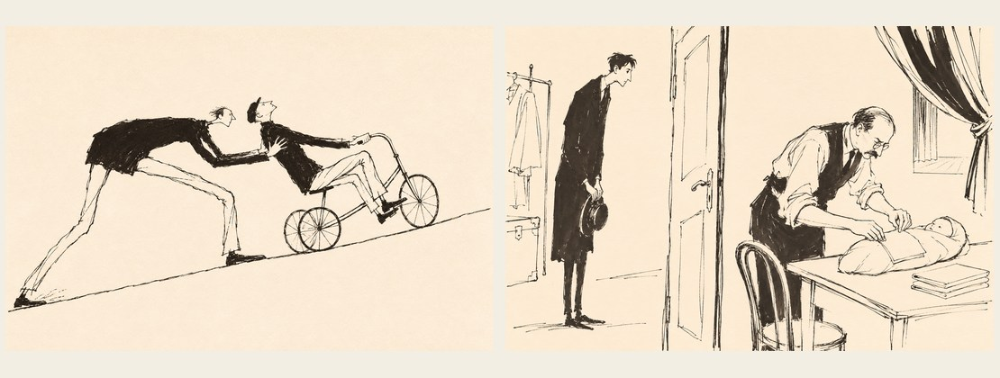
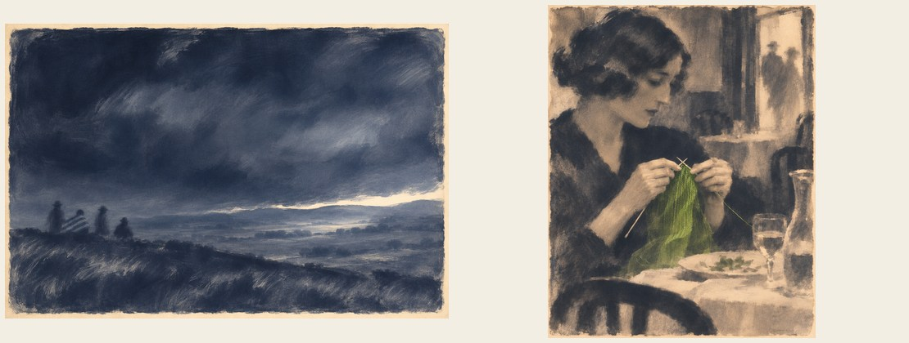

# 日记插画

给一篇日记配图，先找出值得画的那一秒。这个 Skill 从指定的正文里选一个动作或物件，画成可单独保存的插画，也可以把它放回那段文字旁边。连续画一组时，共用一种材质，每篇有自己的构图。

| 黑墨速写 | 剪纸与哑光水粉 | 擦印油墨单版画 |
| --- | --- | --- |
|  |  |  |
| 用重心和姿势交代人物之间的关系 | 用纸层、色块与道具留下生活细节 | 从深墨中擦出光，画出观察改变的瞬间 |

六张样图均为据日记创作的 AI 插画。三套画法也可用于个人日记，作者与媒材可以自由搭配。

## 安装

把这句话发给支持 Skills 的 Agent：

> 请帮我安装日记插画这个 Skill：https://github.com/Tangerine-Cat888/tangerine-cat-diary-illustrations

也可以在终端使用 Node.js 提供的 `npx`：

```sh
npx skills add Tangerine-Cat888/tangerine-cat-diary-illustrations
```

手动安装时，从 [Releases](https://github.com/Tangerine-Cat888/tangerine-cat-diary-illustrations/releases) 下载 `.skill` 包，按 ZIP 解压，把包含 `SKILL.md` 的 `tangerine-cat-diary-illustrations` 文件夹放入宿主的技能目录。

## 使用

附上日记文字或指定笔记，就可以直接说：

- “这段写到一个人在门口等，先帮我想一幅黑墨速写的构图。”
- “给这三篇各画一张，沿用上次的剪纸水粉。先把图给我看。”
- “把这一组还缺图的篇目配齐，插到对应段落，保留原文和脚注。”

构图阶段得到画面方案；试画得到独立图片；要求入库时得到嵌有图片与署名的笔记。日记本封面选图和历史手稿检索适合单独处理。

## 配置与兼容性

本技能无需额外配置。构图可以只用文字；生成成图需要宿主已有的图片生成能力。缺少图像工具时仍可交付构图和绘图提示。使用离线宿主时可在本地处理文字和 Markdown，实际出图取决于该宿主的图像能力。

Obsidian 桌面版可用附带的插图助手预览图位、识别已有插图，再按需要写入。此适配已在 Windows 的桌面库验证；macOS、Linux 和移动端尚未实机验证。其他 Markdown 编辑器可沿用其支持的图片语法。生成单幅插画无需 Obsidian、浏览器或子 Agent。

## 隐私与数据边界

插图助手在本地读取指定笔记、检查指定附件，写入只发生在明确要求嵌图时。仓库中的脚本没有联网调用，也不保存凭据。使用云端 Agent 或图像服务时，输入文字、绘图提示和所提供的参考图会由相应服务处理，费用与数据保留方式取决于服务配置。可仅提供当前段落或脱敏后的场景。

## 验证与排查

有 Node.js 18 或更高版本时，在仓库根目录运行：

```sh
node --test tests/embed.test.cjs
```

若提示图位不唯一，可换一段只出现一次的正文短句。若附件刚保存，可等 Obsidian 索引完成再试。详见[插图与回读](references/obsidian.md)。

## 许可证

技能指令、脚本、文档和六张 AI 示范插画均以 [MIT 许可证](LICENSE) 发布。
